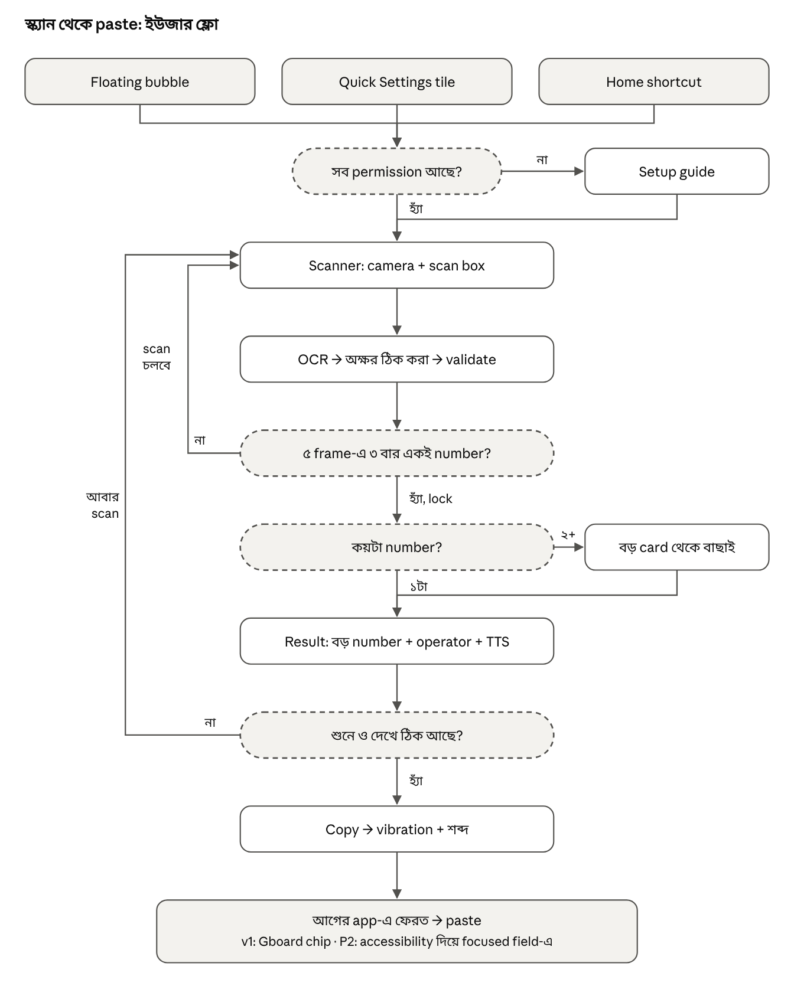
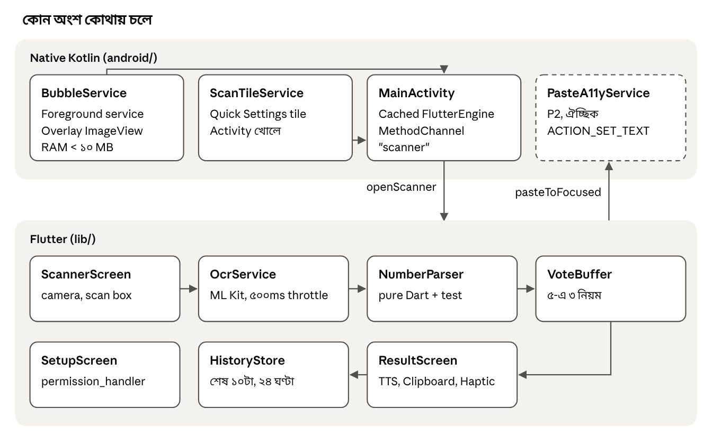

# নাম্বার স্ক্যানার (Sohoj Scan): PRD ও ইউজার ফ্লো

১০ নভেম্বর ২০২৬ · Online version: https://claude.ai/artifact/F7h2jXLnz2S9TSW6BQXK7a

## সারসংক্ষেপ

এটা একটা Android app। Camera ধরলেই হাতে লেখা কাগজ, feature phone বা smartphone-এর screen থেকে বাংলাদেশি mobile number বের করে, বিশাল অক্ষরে দেখায়, পড়ে শোনায় আর এক tap-এ copy করে দেয়। তারপর সেটা বিকাশ, নগদ, রকেট, flexiload বা admin software-এ paste করা যায়।

**সমস্যা:** দোকানে customer number দেন কাগজে লিখে বা phone-এর screen দেখিয়ে। ব্যবহারকারী উচ্চ পাওয়ারের চশমা পরেন, তাই ছোট লেখা পড়ে ১১ digit হাতে টাইপ করা ধীর আর ভুলপ্রবণ। ভুল number-এ টাকা চলে গেলে ফেরত আনা কঠিন।

**লক্ষ্য:**

1. Camera ধরা থেকে copy পর্যন্ত **৩ সেকেন্ডের কম** সময়।
2. ছাপা বা screen-এর number-এ **৯৯%+**, পরিষ্কার হাতের লেখায় **৯৫%+** সঠিকতা (benchmark দিয়ে মাপা হবে)।
3. চশমা ছাড়াও number পড়া ও যাচাই করা যাবে, এমন UI।
4. কোনো ভুল number নিঃশব্দে copy হবে না: প্রতিটা number বড় করে দেখানো ও পড়ে শোনানো হবে।

## ইউজার ও প্রেক্ষাপট

প্রধান ইউজার একজন: দোকান চালান, দিনে অনেকবার MFS ও flexiload করেন, চোখে কম দেখেন।

| বিষয় | বিবরণ | Design-এ প্রভাব |
|---|---|---|
| দৃষ্টি | উচ্চ পাওয়ারের চশমা | number ৭২sp, ৭:১ contrast, শব্দ ও vibration feedback |
| পরিবেশ | দোকান, ভিড়, আলো কখনো কম কখনো বেশি | flashlight, glare-এর জন্য কাত করার ইঙ্গিত |
| হাত | প্রায়ই এক হাতে phone | মূল বোতাম স্ক্রিনের নিচের অর্ধেকে, বুড়ো আঙুলের নাগালে |
| Input-এর উৎস | হাতের লেখা কাগজ, feature phone screen, smartphone screen | তিনটাই একই scanner-এ, আলাদা mode নেই |
| Output-এর গন্তব্য | বিকাশ, নগদ, রকেট, flexiload, admin software | clipboard + Gboard chip; পরে focused field-এ বসানো |
| Phone | Android (model এখনো জানা নেই) | low-end ধরে performance budget |

## Scope

**থাকছে (v1):** ইংরেজি অঙ্কে লেখা BD mobile number; হাতের লেখা, feature phone ও smartphone screen; floating bubble, Quick Settings tile, home shortcut; copy, TTS, history; পুরোপুরি offline।

**থাকছে না:**

- বাংলা অঙ্ক (০১২৩…), পরে ভাবা হবে
- নিজে থেকে টাকা পাঠানো বা কোনো app-এ নিজে থেকে navigate করা
- Internet, account, login, cloud sync
- Landline ও বিদেশি number
- iOS
- Play Store release (v1 হবে sideloaded APK)

## ফিচার ও acceptance criteria

P0 = v1-এ অবশ্যই, P1 = v1-এ থাকলে ভালো, P2 = Phase 2। প্রতিটা শর্ত ভাইয়ের নিজের phone-এ যাচাই হবে।

| ID | ফিচার | Priority | Acceptance criteria |
|---|---|---|---|
| F01 | Floating bubble (native Kotlin) | P0 | সব app-এর উপরে ভাসে; টেনে সরানো যায়, কিনারায় লেগে থাকে; tap করলে ১ সেকেন্ডের মধ্যে scanner; ২৪ ঘণ্টা চালু থাকে; RAM ১০ MB-এর কম; নিচের dismiss zone-এ টেনে নিলে বন্ধ |
| F02 | Quick Settings tile | P0 | Notification shade থেকে এক tap-এ scanner; lock screen থেকে চাপলে আগে unlock চাইবে |
| F03 | Home shortcut + সরাসরি camera | P0 | App খুললে কোনো menu ছাড়া সরাসরি camera; engine cache থাকলে ০.৫ সেকেন্ডে preview |
| F04 | Live OCR + scan box | P0 | Shutter নেই; শুধু scan box-এর ভেতরের লেখা পড়ে; প্রতি ৩০০–৫০০ms-এ একটা frame |
| F05 | Number lock (frame voting) | P0 | শেষ ৫ frame-এর অন্তত ৩টায় একই valid number এলে lock; lock হলে camera থেমে result দেখায় |
| F06 | বিশাল result display | P0 | তিন লাইনে 017 / 1234 / 5678, প্রতি লাইন ৭২sp, ৭:১ contrast, operator-এর নাম |
| F07 | TTS (ইংরেজি, digit-by-digit) | P0 | Lock হলেই নিজে থেকে পড়ে; group-এর মাঝে বিরতি; যে group পড়া হচ্ছে তার নিচে দাগ; "শুনুন" বোতাম |
| F08 | Copy | P0 | একটা বড় বোতাম; copy-তে vibration + শব্দ + লেখায় নিশ্চিতকরণ; copy-র পর আগের app-এ ফেরত |
| F09 | একাধিক number | P0 | ২+ valid number পেলে বড় card-এ তালিকা; tap করে বাছাই |
| F10 | Flashlight + tap-to-focus | P0 | বড় toggle; অন্ধকারে নিজে থেকে চালু করার পরামর্শ দেয় |
| F11 | আবার scan | P0 | ভুল lock হলে এক tap-এ camera-তে ফেরত |
| F12 | History (শেষ ১০টা) | P1 | সময় সহ; tap করলে copy; ২৪ ঘণ্টা পর নিজে থেকে মুছে যায়; সব মুছে ফেলার বোতাম |
| F13 | Setup guide | P0 | Overlay, camera, notification, Autostart, Battery: প্রতিটা আলাদা ধাপ, সবুজ টিক দিয়ে অবস্থা দেখায়; brand অনুযায়ী সঠিক settings screen খোলে |
| F14 | Settings | P1 | লেখার আকার, theme (dark/light/high contrast), TTS গতি, bubble-এর আকার, শব্দ on/off |
| F15 | Accessibility paste | P2 | ভাই নিজে field-এ tap করবেন → bubble থেকে confirm → `ACTION_SET_TEXT`; field phone-টাইপ না হলে বসাবে না |
| F16 | ভয়েস দিয়ে নাম্বার | P1 | Scanner screen-এ বড় mic বোতাম; বলার সাথে সাথে digit স্ক্রিনে ওঠে; valid নাম্বার হলে ১ সেকেন্ড চুপ থাকার পর নিজে থেকে থামে; তারপর result screen; দোকানে ১০টার মধ্যে ৯টা নাম্বার প্রথমবারেই ঠিক; পুরো offline |

## F16 — ভয়েস দিয়ে নাম্বার (Voice input)

Customer ইংরেজিতে একটা একটা digit করে নাম্বার বলবেন, app সেটা লিখে নেবে। এরপর আগের মতোই result screen আসবে: বড় করে দেখানো, পড়ে শোনানো আর copy।

**Engine:** Vosk, ছোট English model (`vosk-model-small-en-us-0.15`), পুরো offline। Recognizer-কে একটা grammar দেওয়া থাকবে, তাই সে শুধু এই ১৩টা শব্দ চিনবে: zero, oh, one, two, three, four, five, six, seven, eight, nine, double, triple (সাথে `[unk]`, মানে অচেনা শব্দ)।

**Flow:**

1. ভাই "বলে দিন" mic বোতামে চাপ দেবেন। স্ক্রিনে amber pill-এ "শুনছি…" দেখাবে, সাথে ১১টা ফাঁকা ঘর (3-4-4)।
2. Customer বলবেন: "zero one seven, one two three four, five six seven eight"।
3. প্রতিটা digit শোনার সাথে সাথে ঘরে বসে যাবে।
4. Valid নাম্বার হওয়ার পর ১ সেকেন্ড নতুন কিছু না শুনলে নিজে থেকে থামবে। তারপর ছোট vibration হবে আর result screen আসবে।
5. ১২ সেকেন্ডেও valid নাম্বার না হলে থামবে। তখন যা শুনেছে সেটা দেখাবে, ফাঁকা ঘরগুলো লাল দাগে চিহ্নিত থাকবে, আর থাকবে "আবার বলুন" বোতাম।
6. কোনো একটা group-এ (যেমন 1234) tap করলে শুধু সেই group আবার বলা যাবে।

**নিয়ম:**

- "oh" = 0; "double X" = XX; "triple X" = XXX।
- শুরুতে "eight eight" (88) থাকলে আগের `findNumbers()`-এর নিয়মেই বাদ যাবে।
- `[unk]` উপেক্ষা করা হবে।
- Vosk-এর final result-এ যে শব্দের confidence ০.৬০-এর কম, সেই digit amber দাগে দেখাবে।
- Customer-এর জন্য নির্দেশনা স্ক্রিনে লেখা থাকবে ইংরেজিতে: "Please say your number in English, one digit at a time."

**Permission:** `RECORD_AUDIO` (প্রথমবার mic চাপলে চাইবে)। Internet লাগবে না।

**APK:** model-এর কারণে প্রায় ৪০MB বাড়বে। এটা মেনে নেওয়া হয়েছে।

## ইউজার ফ্লো

App-এ ঢোকার তিনটা পথ, সবগুলো একই scanner-এ যায়। ভুল lock হলে বা শুনে ভুল মনে হলে এক tap-এ আবার scan-এ ফেরা যায়, তাই যাচাই না করে কিছু copy হয় না।

**Happy path-এ ইউজারের কাজ মাত্র ৩টা:** bubble-এ tap → camera ধরা → Copy-তে tap। বাকি সব (lock, পড়ে শোনানো, আগের app-এ ফেরা) নিজে থেকে হয়।

সব screen-এর design দেখুন `design/screens.html`-এ।

## Number parsing নিয়ম

এই নিয়মগুলোর কোড `lib/core/number_parser.dart`-এ, test আছে `test/number_parser_test.dart` আর `test/fixtures/number_cases.json`-এ।

1. **Token বাছাই:** প্রতিটা OCR line-কে space দিয়ে ভাগ করা হয়। কোনো token-এ অন্তত ২টা আসল digit থাকলে, আর অন্তত ৬০% অক্ষর digit বা নিচের টেবিলের অক্ষর হলে, সেটাকে number-এর অংশ ধরা হয়।
2. **অক্ষর → অঙ্ক:** শুধু সেই token-গুলোর ভেতরে বদলানো হয়।
3. **পরিষ্কার:** digit-গুলোর মাঝখানের space, `-`, `.`, `(`, `)` বাদ যায়।
4. **Prefix:** শুরুতে `+88`, `0088` বা `88` থাকলে বাদ যায়।
5. **Validate:** `01[3-9]` + ৮ digit, ঠিক ১১টা। আগে বা পরে আরও digit লেগে থাকলে (যেমন account number-এর ভেতরে) বাতিল।
6. **Voting:** শেষ ৫ frame-এর মধ্যে ৩টায় একই number এলে তবেই lock (`lib/core/vote_buffer.dart`)।

| OCR-এ পড়া | বদলাবে |
|---|---|
| O, o, D, Q | 0 |
| I, l, \|, i, L | 1 |
| Z, z | 2 |
| A | 4 |
| S, s | 5 |
| G, b | 6 |
| T | 7 |
| B | 8 |
| g, q | 9 |

| Prefix | Operator |
|---|---|
| 013, 017 | Grameenphone |
| 018 | Robi |
| 016 | Airtel |
| 014, 019 | Banglalink |
| 015 | Teletalk |

Operator টেবিল release-এর আগে BTRC-এর সর্বশেষ তালিকার সাথে মিলিয়ে নেবেন। Display format: `0XX XXXX XXXX` (৩-৪-৪); clipboard-এ যায় শুধু ১১টা digit।

## আর্কিটেকচার ও stack

মূল app Flutter-এ। শুধু যে অংশগুলো সবসময় চালু থাকে বা Android system-এর সাথে কাজ করে, সেগুলো native Kotlin-এ। Bubble আলাদা কোনো Flutter engine চালায় না, তাই RAM কম লাগে আর OS সহজে সেটা বন্ধ করে দেয় না।

| কাজ | Package / API |
|---|---|
| Camera | `camera` (ImageFormatGroup.nv21) |
| OCR | `google_mlkit_text_recognition` (Latin, on-device) |
| TTS | `flutter_tts` (en-US / en-IN) |
| Permission | `permission_handler` |
| History | `shared_preferences` |
| Haptic, Clipboard | Flutter SDK (`HapticFeedback`, `Clipboard`) |
| Bubble, Tile | Kotlin: `Service` + `WindowManager`, `TileService` (দেখুন `android_native/`) |
| Flutter ↔ native | `MethodChannel("scanner")`: `openScanner`, `startBubble`, `stopBubble`, `canDrawOverlays`, পরে `pasteToFocused(number)` |
| Font | Atkinson Hyperlegible Next/Mono + Noto Sans Bengali, `assets/fonts/`-এ bundle করা (offline) |

Release build-এ internet permission থাকবে না। `minSdk` 26 (Android 8.0), `targetSdk` সর্বশেষ।

## Accessibility requirements

এখানে low vision-কেই কেন্দ্রে রাখা হয়েছে, আর সব মাপ ধরা হয়েছে WCAG 2.2 AAA অনুযায়ী। Design system-এর token-গুলো (`docs/design-system/tokens.json`) এই টেবিল থেকেই এসেছে।

| বিষয় | নিয়ম |
|---|---|
| Number-এর আকার | Result-এ ৭২sp, তিন লাইনে; card-এ ৩২sp; history-তে ২৮sp; Atkinson Hyperlegible Mono (1/7, 0/O আলাদা চেনা যায়) |
| Body text | ন্যূনতম ২০sp, caption ১৮sp; সব লেখা sp-এ, যাতে system font scale ২০০% পর্যন্ত কাজ করে |
| Contrast | লেখা ৭:১ বা বেশি; আইকন ও border ৩:১ বা বেশি; তিনটা theme-এই |
| Touch target | ন্যূনতম ৬৪dp; প্রধান বোতাম ৮৮dp উঁচু, পুরো চওড়া; দুই বোতামের মাঝে অন্তত ১৬dp |
| শুধু রঙে নির্ভর না করা | প্রতিটা অবস্থা জানানো হবে রঙ + আইকন + লেখা + শব্দ/vibration একসাথে |
| Feedback প্যাটার্ন | Lock: একটা নরম beep + ছোট vibration; Copy: দুইটা ছোট vibration + "কপি হয়েছে"; Error: একটা লম্বা vibration |
| TTS | Digit-by-digit, ৩-৪-৪ group-এ বিরতি, গতি ০.৮৫× default, সেটিংসে বদলানো যায় |
| Motion | Scan box-এর অ্যানিমেশন সূক্ষ্ম; system-এ "Remove animations" চালু থাকলে বন্ধ |
| Theme | Dark (default), Light, High contrast |
| এক হাতে ব্যবহার | সব কাজের বোতাম স্ক্রিনের নিচের ৪০%-এ |
| TalkBack | সব আইকন ও বোতামে `Semantics` label; number পড়ার সময় digit আলাদা করে |
| ভাষা | UI বাংলায়, number ও TTS ইংরেজিতে |

## Performance, privacy ও permission

| বিষয় | লক্ষ্য |
|---|---|
| Bubble tap → camera preview | ≤ ০.৫ s (warm), ≤ ১.৫ s (cold) |
| Camera ধরা → lock | ≤ ১.৫ s, ছাপা বা screen-এর লেখায় |
| Bubble-এর RAM | < ১০ MB |
| APK | < ২৫ MB |
| Battery | Scanner বন্ধ থাকলে camera ও OCR পুরো বন্ধ |

**Privacy:** কোনো internet permission নেই; ছবি disk-এ save হয় না; history শুধু phone-এ থাকে, ২৪ ঘণ্টা পর নিজে থেকে মুছে যায়। Clipboard-এ number যায় সাধারণ text হিসেবে (sensitive হিসেবে চিহ্নিত না), যাতে Gboard chip দেখায়।

| Permission | কেন লাগে | কখন চাইবে |
|---|---|---|
| `CAMERA` | Scan | প্রথম setup |
| `SYSTEM_ALERT_WINDOW` | Floating bubble | প্রথম setup (settings screen-এ নিয়ে যাবে) |
| `FOREGROUND_SERVICE` + `_SPECIAL_USE` | Bubble চালু রাখা | স্বয়ংক্রিয় |
| `POST_NOTIFICATIONS` | Foreground notification (Android 13+) | প্রথম setup |
| `VIBRATE` | Feedback | স্বয়ংক্রিয় |
| Battery optimization বাদ + Autostart | OEM যাতে bubble বন্ধ না করে | Setup guide (Xiaomi, Oppo, Vivo, Realme, Infinix) |
| Accessibility service | Phase 2 paste | P2, আলাদা ব্যাখ্যাসহ |

## Milestones ও Claude দিয়ে বানানোর ধাপ

MVP-তে মোট ২–৩ সপ্তাহ লাগবে। প্রতিটা ধাপ Claude-কে আলাদা prompt-এ দিন। ভাইয়ের phone-এ চালিয়ে দেখে তবেই পরের ধাপে যাবেন।

| # | ধাপ | সময় | কখন শেষ ধরবেন | অবস্থা |
|---|---|---|---|---|
| 0 | Repo + `CLAUDE.md` + PRD ও design system `docs/`-এ | ½ দিন | Claude প্রজেক্ট বুঝে প্রশ্নের উত্তর দিতে পারে | ✅ এই zip-এ |
| 1 | Design tokens + theme (Flutter `ThemeData`) | ½ দিন | Token থেকে তিনটা theme বদলানো যায় | ✅ এই zip-এ |
| 2 | `NumberParser` + unit test | ১ দিন | Fixture-এর সব case pass | ✅ এই zip-এ |
| 3 | Camera + OCR + scan box + voting | ৩–৪ দিন | ছাপা number ১.৫ s-এ lock | ⬜ |
| 4 | Result + TTS + copy + multi-number | ২ দিন | F06–F09, F11 pass | 🟨 Result screen শুরু করা আছে |
| 5 | Native bubble + tile + MethodChannel | ২–৩ দিন | F01, F02 pass; ২৪ ঘণ্টা টিকে থাকে | 🟨 Kotlin reference `android_native/`-এ |
| 6 | Setup guide + history + settings | ২ দিন | F12–F14 pass | ⬜ |
| 7 | ভাইয়ের সাথে ১ সপ্তাহ ব্যবহার + tuning | ৭ দিন | সমস্যার তালিকা ফাঁকা | ⬜ |
| 8 | Phase 2: accessibility paste (দরকার হলে) | ৩–৫ দিন | F15 pass | ⬜ |

## Open questions

- ভাইয়ের phone-এর model, Android version ও RAM কত?
- উনি Gboard ব্যবহার করেন, নাকি brand-এর নিজস্ব keyboard?
- Dark না Light, কোন theme-এ উনি বেশি আরাম পান? (দুটোই দেখিয়ে ঠিক করবেন)
- TTS-এ ইংরেজি digit উনি সহজে বোঝেন, নাকি বাংলায় "শূন্য এক সাত" পড়লে ভালো?
- App-এর চূড়ান্ত নাম (কাজের নাম: Sohoj Scan)
